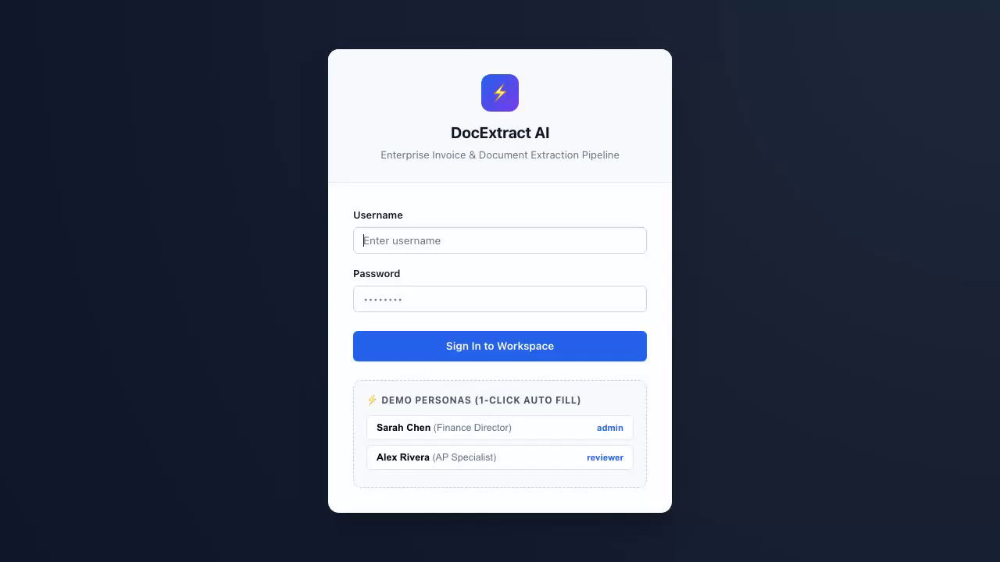
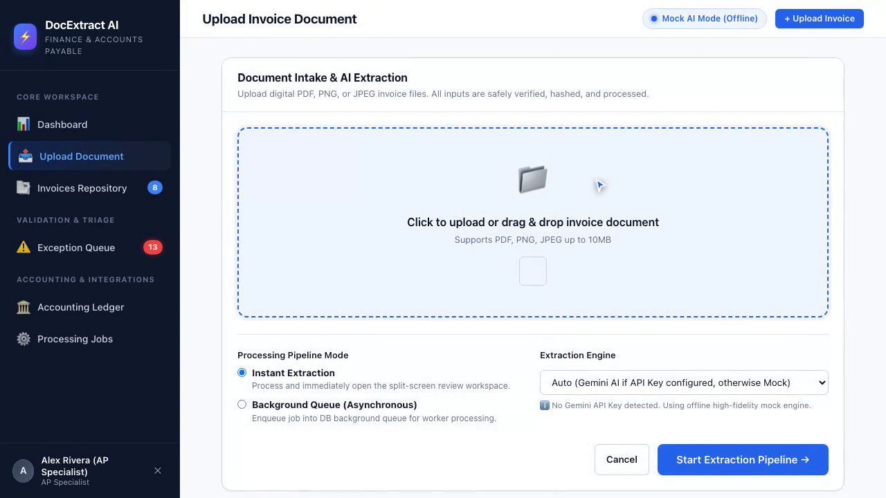
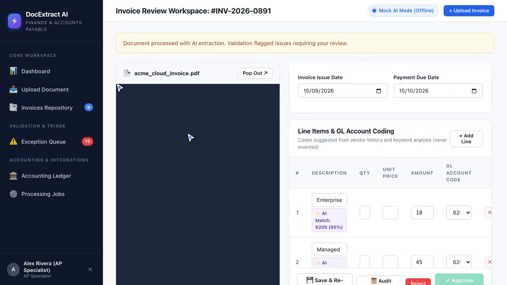
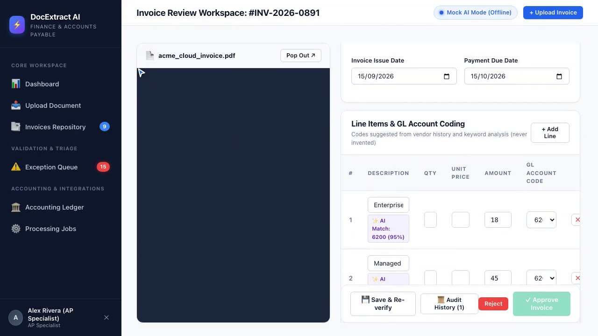

# ⚡ DocExtract AI — Enterprise AI Invoice & Document Extraction Pipeline

A complete, production-grade, portfolio-quality **AI Invoice and Document Data Extraction Pipeline** built with Django, SQLite, Pydantic, and Google Gemini.

Designed for Accounts Payable (AP) and finance automation teams, this platform ingests raw invoice documents (PDF, PNG, JPEG), extracts itemized financial data using multimodal AI or high-fidelity offline simulation, enforces strict independent financial arithmetic validation, provides an interactive split-screen human review workspace, intelligently suggests General Ledger (GL) account codes without hallucinations, and synchronizes draft bills to general ledger accounting systems.

---

## 🌟 Key Architecture & Capabilities

```
┌─────────────────┐       ┌────────────────────────┐       ┌────────────────────────┐
│ Document Intake │ ────> │ Gemini 2.5 Flash /     │ ────> │ Strict Pydantic Schema │
│ PDF, PNG, JPEG  │       │ High-Fidelity Mock AI  │       │ Parsing & Normalization│
└─────────────────┘       └────────────────────────┘       └────────────────────────┘
                                                                       │
                                                                       ▼
┌─────────────────┐       ┌────────────────────────┐       ┌────────────────────────┐
│ Human Review &  │ <──── │ Independent Financial  │ <──── │ Intelligent GL Account │
│ Split-Screen UI │       │ Validation Rules Engine│       │ Coding Suggestions     │
└─────────────────┘       └────────────────────────┘       └────────────────────────┘
        │
        ▼
┌─────────────────────────┐       ┌─────────────────────────┐
│ Immutable Audit Trail   │ ────> │ Enterprise Accounting   │
│ & Security Gate Enforce │       │ Adapter (Draft Bills)   │
└─────────────────────────┘       └─────────────────────────┘
```

### 1. Document Intake & Multi-Format Validation
- Drag-and-drop intake for **PDF, PNG, and JPEG** invoices with magic-byte and file-size validation (up to 10MB).
- Computes SHA-256 content hashes upon upload for duplicate detection.
- Supports both **Instant Processing** and **Asynchronous Background Processing** via a lightweight database-backed job queue.

### 2. Dual-Engine Extraction (Gemini AI + Offline Mock Mode)
- **Google Gemini 2.5 Flash**: Employs `google-genai` SDK with strict JSON schema constraints and hardened system prompts defending against prompt injection.
- **Offline Demonstration Mode**: High-fidelity, deterministic mock extraction engine with pre-built synthetic templates, allowing 100% offline demonstration without API keys or costs.

### 3. Independent Validation Engine (Python Decimal Precision)
- **Financial Calculation Verification**: `Subtotal + Tax == Total` computed using `decimal.Decimal` to avoid floating-point drift.
- **Line-Item Checks**: Sum of itemized lines verified against stated subtotal; individual line arithmetic (`quantity * unit_price == total`) verified.
- **Duplicate Prevention**: Detects exact file duplicates via SHA-256 hash matching and semantic duplicates via `Supplier + Invoice Number` matching.
- **Supplier Verification**: Fuzzy and normalized name matching against recognized supplier registry.
- **Confidence Scoring**: Flags extractions with confidence `< 80%` for mandatory human review.
- **Approval Gate**: Invoices with unresolved blocking errors cannot be approved.

### 4. Interactive Human Review Workspace
- **Split-Screen Layout**: View original PDF/image alongside editable extracted form fields and line items.
- **Dynamic Line Items**: Real-time JavaScript line item calculation, addition, deletion, and GL account assignment.
- **Issue Resolver**: Interactive badges explaining the root cause of every validation issue with 1-click resolution.
- **Approval & Rejection Gates**: Enforces strict audit-logged sign-offs with mandatory rejection notes.

### 5. Intelligent Account Coding Suggestion Engine
- Learns from supplier defaults and historical approved line item keywords.
- Explicitly returns `None` and displays *"No historical coding available — manual selection required"* when evidence is insufficient. Strictly avoids guessing or hallucinating chart of accounts codes.

### 6. Exception Queue
- Filterable triage center categorized by:
  - **Arithmetic Mismatches**
  - **Duplicate Invoices**
  - **Unknown Suppliers**
  - **Missing Required Fields**
  - **Low AI Confidence**
  - **Extraction / Processing Failures**

### 7. Accounting Adapter & Draft Bill Synchronization
- Pluggable `AccountingAdapter` architecture with a fully functional `MockAccountingAdapter` and extensible `XeroAccountingAdapter` skeleton.
- Generates simulated draft bills (e.g. `MOCK-BILL-XXXXXXXX`) with complete line-item payloads.
- **Strict Idempotency**: Prevents duplicate bill creation and records timestamped export logs.

### 8. Database-Backed Background Processing
- Lightweight DB queue avoiding Celery/Redis overhead.
- Dedicated management command (`python manage.py process_jobs --watch`) with automated retry logic for transient errors.

### 9. Security & Immutable Audit Trail
- Multi-user role-based access (Director of Finance, AP Specialist).
- Every event (Upload, Extraction, Edit, Resolution, Approval, Rejection, Export Attempt, Export Success/Failure) recorded with user, timestamp, before/after diffs, and IP.

---


## 🖼️ Application Screenshots

| Multi-Format Invoice Intake & Parsing | Review Workbench & Math Validation |
|:---:|:---:|
|  |  |
| *Document extraction with bounding-box OCR highlights* | *Interactive line item reconciliation & confidence scores* |

| Smart GL Coding & Rule Suggestions | Export & ERP Integration |
|:---:|:---:|
|  |  |
| *Automated chart-of-accounts mapping & policy checks* | *One-click sync to QuickBooks, NetSuite, & Xero formats* |

## 🚀 Quick Start Guide

### Prerequisites
- Python 3.10+ (Tested on Python 3.13)
- SQLite (included with Python)

### 1. Setup Virtual Environment
```bash
python3 -m venv .venv
source .venv/bin/activate
pip install -r requirements.txt
```

### 2. Configure Environment Variables
Copy the example environment file:
```bash
cp .env.example .env
```
*(Optional: Add your `GEMINI_API_KEY` in `.env` to enable live Gemini AI extraction. If omitted, the application automatically runs in offline mock mode).*

### 3. Run Database Migrations
```bash
python manage.py migrate
```

### 4. Seed Comprehensive Portfolio Demo Data
This creates demo users, chart of accounts, approved suppliers, and generates 7 realistic synthetic invoice documents:
```bash
python manage.py seed_data
```

### 5. Run the Application
Start the Django development server:
```bash
python manage.py runserver
```
Visit **[http://127.0.0.1:8000](http://127.0.0.1:8000)** in your browser.

---

## 👥 Demo User Personas

| Role | Username | Password | Permissions |
| :--- | :--- | :--- | :--- |
| **Finance Director** | `admin` | `admin12345` | Full administrative control, approval & batch exports |
| **AP Specialist** | `reviewer` | `finance12345` | Intake uploads, review workspace, issue resolution |

*(Quick 1-click login buttons are provided on the login page for testing convenience).*

---

## 🧪 Running the Test Suite

Run the automated test suite covering extraction schemas, validation rules, duplicate detection, review workflows, approval gates, and accounting export idempotency:

```bash
python manage.py test
```

---

## ⚙️ Background Job Processing Worker

To run the background queue processor in continuous worker mode:

```bash
python manage.py process_jobs --watch --interval 2.0
```

Or execute pending jobs in a single batch pass:
```bash
python manage.py process_jobs --limit 10
```

---

## 📂 Project Structure

```
├── config/                      # Project configuration and settings
│   ├── settings.py              # Environment configuration, logging, media/static
│   ├── urls.py                  # Root URL configuration
│   └── wsgi.py
├── invoices/                    # Main Invoices Application
│   ├── models.py                # Document, Invoice, LineItem, ValidationIssue, AuditLog, etc.
│   ├── context_processors.py    # Global navigation status metrics
│   ├── urls.py                  # Invoices app URL routes
│   ├── services/
│   │   ├── schemas.py           # Strict Pydantic extraction schemas
│   │   ├── gemini_extractor.py  # Google Gemini 2.5 Flash API client
│   │   ├── mock_extractor.py    # High-fidelity offline mock extractor
│   │   ├── extraction_service.py# Extraction pipeline orchestrator
│   │   ├── validation_service.py# Independent financial validation rules
│   │   ├── suggestion_service.py# Account coding suggestion engine
│   │   ├── audit_service.py     # Centralized immutable audit logger
│   │   └── job_service.py       # Database-backed background job queue
│   ├── adapters/
│   │   ├── base.py              # AccountingAdapter abstract interface
│   │   ├── mock_adapter.py      # Mock general ledger adapter with idempotency
│   │   ├── xero_adapter.py      # Production-ready Xero adapter skeleton
│   │   └── factory.py           # Adapter factory
│   ├── views/
│   │   ├── auth_views.py        # Login / logout views
│   │   ├── dashboard_views.py   # Metrics and KPIs overview
│   │   ├── document_views.py    # Document list, upload, reprocessing
│   │   ├── review_views.py      # Split-screen review, issue resolution, approval
│   │   ├── exception_views.py   # Categorized exception queue
│   │   ├── export_views.py      # Accounting ledger & batch export
│   │   ├── job_views.py         # Background jobs monitoring console
│   │   └── api_views.py         # JSON endpoints for live suggestions & job polling
│   ├── utils/
│   │   └── fixture_generator.py # Synthetic PDF & image invoice generator (ReportLab/Pillow)
│   ├── management/commands/
│   │   ├── seed_data.py         # Database seeding and fixture ingestion
│   │   └── process_jobs.py      # Background worker management command
│   └── tests/                   # Comprehensive automated test suite
├── static/                      # Custom CSS design system and JavaScript
│   ├── css/styles.css           # Financial dashboard and review UI stylesheet
│   └── js/main.js               # Vanilla JS dynamic line calculations and dropzone
├── templates/invoices/          # Django HTML templates
├── requirements.txt             # Project dependencies
├── .env.example                 # Environment configuration template
└── README.md                    # Project documentation
```
